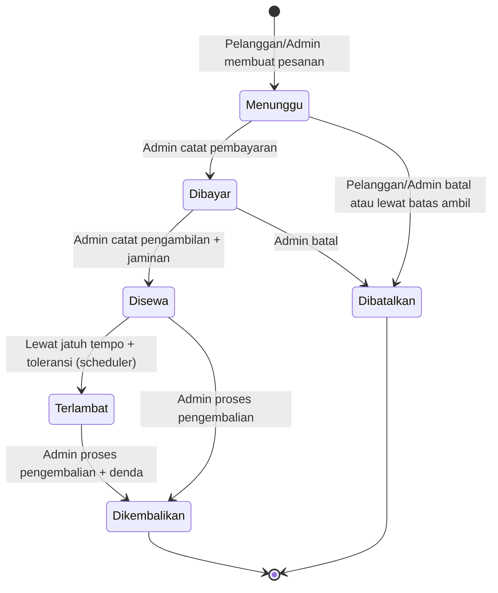
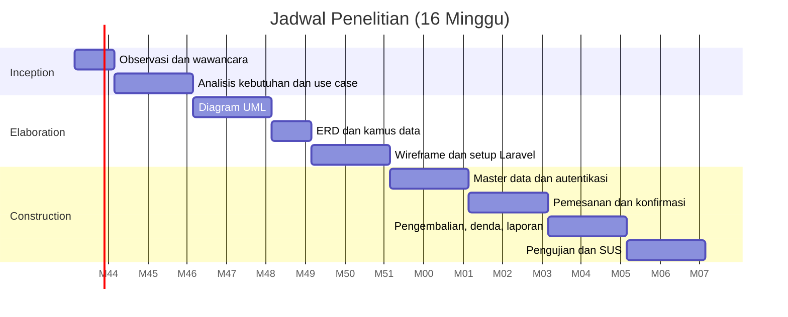

# 2. Perencanaan Proyek

## 2a. Daftar Fitur Final per Aktor

Kolom "Asal": F = kebutuhan awal (disempurnakan), T = tambahan dari dokumen 01.

| Kode | Fitur | Pemilik | Admin | Pelanggan | Asal |
|---|---|---|---|---|---|
| F01 | Login dan logout sesuai hak akses | ✔ | ✔ | ✔ | F01 |
| F02a | Kelola data alat (CRUD, foto, harga per hari, stok) | – | ✔ | – | F02, T02 |
| F02b | Kelola kategori alat | – | ✔ | – | T01 |
| F02c | Kelola data pelanggan | – | ✔ | – | F02 |
| F03 | Daftar akun pelanggan | – | – | ✔ | F03 |
| F04a | Lihat katalog dan cek ketersediaan per tanggal | – | ✔ | ✔ | T03 |
| F04b | Pemesanan sewa (alat, jumlah, tanggal) dan nomor resi | – | – | ✔ | F04 |
| F04c | Pesanan walk-in oleh Admin | – | ✔ | – | T08 |
| F05a | Konfirmasi pembayaran manual | – | ✔ | – | F05 |
| F05b | Konfirmasi pengambilan dan pencatatan jaminan identitas | – | ✔ | – | F05, T04 |
| F05c | Pembatalan pesanan | – | ✔ | ✔ (status Menunggu) | T07 |
| F06a | Proses pengembalian dan kondisi alat | – | ✔ | – | F06, T06 |
| F06b | Denda keterlambatan dan biaya kerusakan (catat dan lunasi) | – | ✔ | lihat | T05, T11 |
| F06c | Pengembalian jaminan identitas | – | ✔ | – | T04 |
| F07 | Riwayat penyewaan | – | ✔ (semua) | ✔ (milik sendiri) | F07 |
| F08a | Laporan penyewaan, pendapatan, denda, alat terlaris | ✔ (lihat dan cetak) | ✔ (sediakan) | – | F08 |
| F08b | Cetak PDF (Excel bersyarat) | ✔ | ✔ | – | T10, T13 |
| F09 | Kelola data user dan role | – | ✔ (Pelanggan dan Admin) | – | F09 |
| T09 | Dashboard | ✔ | ✔ | ringkasan pesanan sendiri | T09 |
| T14 | Tautan WhatsApp | – | ✔ | – | T14 (bersyarat) |
| T15 | Log aktivitas | ✔ (lihat) | ✔ (lihat) | – | T15 (bersyarat) |
| – | Pengaturan (tarif denda, jam kembali) | ✔ | – | – | – |

> Keputusan: akun Admin hanya dibuat oleh Pemilik atau seeder. Admin tidak boleh membuat akun Pemilik, agar tidak ada eskalasi hak akses.

### Kebutuhan Non-Fungsional

| Kode | Kategori | Kebutuhan |
|---|---|---|
| NF01 | Keamanan | Password di-hash (bcrypt), CSRF aktif, otorisasi per role, session timeout |
| NF02 | Keamanan | Upload gambar divalidasi (jpg/png/webp, maks 2 MB), nama file di-random |
| NF03 | Integritas data | Transaksi database untuk pembuatan pesanan, pengambilan, dan pengembalian |
| NF04 | Kinerja | Halaman utama termuat kurang dari 3 detik pada jaringan seluler normal |
| NF05 | Kegunaan | Responsif (mobile first), karena pelanggan mengakses dari ponsel. Target SUS ≥ 68 |
| NF06 | Portabilitas | Berjalan di browser modern (Chrome, Edge, Firefox) |
| NF07 | Keandalan | Ketersediaan alat konsisten (tidak boleh melebihi stok) walau dua pesanan masuk bersamaan (locking) |
| NF08 | Pemeliharaan | Kode MVC, penamaan konsisten, migration versioned |
| NF09 | Privasi | Nomor identitas jaminan hanya disimpan dalam bentuk disamarkan (empat digit terakhir) |

## 2b. Aturan Bisnis

### BR-1 Status Pesanan

| Status | Arti | Diatur oleh |
|---|---|---|
| `menunggu` | Pesanan dibuat, belum dibayar | Pelanggan atau Admin |
| `dibayar` | Pembayaran sewa dicatat di toko, alat belum diambil | Admin |
| `disewa` | Alat diambil dan jaminan dicatat | Admin |
| `terlambat` | Status `disewa` dan melewati jatuh tempo + toleransi | Sistem (scheduler) |
| `dikembalikan` | Alat sudah dikembalikan dan diperiksa | Admin |
| `dibatalkan` | Dibatalkan pelanggan, admin, atau otomatis | Pelanggan, Admin, Sistem |

### BR-2 Perhitungan Total
- `durasi_hari = tanggal_selesai − tanggal_mulai`, minimal 1.
- `subtotal = harga_per_hari × jumlah × durasi_hari`.
- `total_sewa = Σ subtotal`.
- `harga_per_hari` disalin ke `pesanan_detail` saat pemesanan (snapshot), sehingga perubahan harga tidak mengubah transaksi lama.
- Contoh: Tenda Dome 4 (Rp50.000) × 1, Carrier 60L (Rp30.000) × 2, 3 hari → (50.000 + 60.000) × 3 = **Rp330.000**.

### BR-3 Ketersediaan dan Stok
- `tersedia(alat, tanggal) = stok_total − stok_perawatan − Σ jumlah pesanan aktif yang mencakup tanggal tersebut`.
- Pesanan aktif: status `menunggu`, `dibayar`, `disewa`, `terlambat`.
- Rentang pesanan bersifat **[tanggal_mulai, tanggal_selesai)**. Tanggal selesai dapat dipakai pesanan lain pada hari yang sama.
- Permintaan valid bila `tersedia ≥ jumlah` pada **setiap hari** dalam rentang.
- Pesanan `terlambat` terus menahan stok sampai dikembalikan.
- Stok tidak dikurangi saat memesan. Ketersediaan dihitung dari pesanan aktif.
- Maksimal durasi 14 hari dan tanggal mulai minimal hari ini (parameter dapat diubah).

### BR-4 Pembayaran dan Jaminan
- Pembayaran sewa dicatat Admin setelah uang diterima di toko (tunai atau transfer manual).
- Pesanan baru boleh `disewa` jika sudah ada pembayaran senilai total sewa dan jaminan identitas tercatat.
- Jaminan: jenis (KTP, SIM, kartu pelajar, lainnya) dan empat digit terakhir nomor. Dikembalikan saat pengembalian selesai, atau tetap `dititipkan` bila denda belum lunas (kebijakan toko, opsional).

### BR-5 Keterlambatan dan Denda
- `jatuh_tempo = tanggal_selesai + jam_kembali` (default 12:00).
- Terlambat jika `waktu_kembali > jatuh_tempo + toleransi (60 menit)`.
- `hari_terlambat = ceil((waktu_kembali − jatuh_tempo) / 24 jam)`.
- `denda_keterlambatan = hari_terlambat × Σ(harga_per_hari × jumlah) × persen_denda` (default 100%).
- Denda dicatat sebagai tagihan `belum_lunas` dan dilunasi manual di toko.

### BR-6 Kondisi Alat dan Biaya Kerusakan
- Setiap baris alat saat kembali dibagi: `baik + rusak_ringan + rusak_berat + hilang = jumlah disewa`.
- `rusak_ringan` dan `rusak_berat`: `stok_perawatan` bertambah. Selesai diperbaiki, Admin menguranginya (fitur Perawatan).
- `hilang`: `stok_total` berkurang.
- Biaya kerusakan atau kehilangan diisi Admin (nominal bebas) dan dicatat sebagai denda jenis `kerusakan`.

### BR-7 Pembatalan
| Kondisi | Pelaku | Hasil |
|---|---|---|
| Status `menunggu` | Pelanggan atau Admin | `dibatalkan` |
| Status `dibayar` | Admin saja | `dibatalkan`, pengembalian uang di luar sistem (dicatat di alasan) |
| Status `menunggu` dan melewati `batas_ambil` | Sistem | `dibatalkan` otomatis |
| Status `disewa` atau lebih | Tidak boleh dibatalkan | – |
- `batas_ambil = tanggal_mulai pukul 23:59`.

### BR-8 Data dan Hak Akses
- Pelanggan hanya melihat pesanan sendiri.
- Data dengan riwayat transaksi tidak dihapus permanen (soft delete).
- Setiap perubahan status penting dicatat di `log_aktivitas`.

## 2c. Diagram Status Pesanan

## 2d. Rencana Kerja per Fase RUP (16 minggu)

| Fase | Aktivitas | Deliverable | Minggu |
|---|---|---|---|
| **Inception** | Observasi dan wawancara pemilik dan karyawan; identifikasi masalah; analisis kebutuhan (fungsional, non-fungsional); penetapan batasan; use case diagram | Dokumen kebutuhan, use case, batasan masalah | 1–3 |
| **Elaboration** | Skenario use case; activity, robustness, sequence, class diagram; ERD dan kamus data; wireframe Figma; setup proyek Laravel; prototipe arsitektur (autentikasi dan cek ketersediaan sebagai proof of concept) | Kumpulan diagram UML, ERD, wireframe, kerangka proyek | 4–8 |
| **Construction (iterasi 1)** | Migration, seeder, autentikasi dan role, CRUD alat, kategori, pelanggan, user | Modul master data berjalan | 9–10 |
| **Construction (iterasi 2)** | Katalog, ketersediaan, pemesanan, pembayaran, pengambilan, jaminan, pembatalan | Alur sewa inti | 11–12 |
| **Construction (iterasi 3)** | Pengembalian, denda, kondisi alat, riwayat, dashboard, laporan PDF | Alur lengkap sampai laporan | 13–14 |
| **Construction (iterasi 4)** | Black box testing, perbaikan bug, usability testing (SUS), penulisan Bab IV–V | Laporan pengujian, sistem final | 15–16 |

Tabel bergaya Tabel 1 Workflow RUP (untuk Bab III), isi tanda ✔ pada sel yang sesuai:

| Workflow | Inception | Elaboration | Construction |
|---|---|---|---|
| Observasi dan wawancara | ✔ | | |
| Identifikasi masalah | ✔ | | |
| Analisis kebutuhan | ✔ | ✔ | |
| Analisis sistem | | ✔ | |
| Perancangan UML | | ✔ | |
| Perancangan database | | ✔ | |
| Perancangan antarmuka | | ✔ | |
| Implementasi | | | ✔ |
| Pengujian | | | ✔ |

## 2e. Sitemap

### Pelanggan
| Halaman | URL | Keterangan |
|---|---|---|
| Beranda | `/` | Profil toko, alat unggulan |
| Katalog alat | `/alat` | Filter kategori dan pencarian |
| Detail alat | `/alat/{id}` | Harga, stok, cek ketersediaan tanggal |
| Login, Daftar | `/login`, `/register` | Autentikasi |
| Keranjang/Form pesanan | `/pesanan/buat` | Alat, jumlah, tanggal |
| Konfirmasi dan resi | `/pesanan/{id}` | Detail, nomor resi, tautan WA |
| Riwayat pesanan | `/pesanan` | Daftar dan status |
| Profil | `/profil` | Ubah data dan password |

### Admin
| Halaman | URL |
|---|---|
| Dashboard | `/admin` |
| Data alat (list, tambah, ubah) | `/admin/alat` |
| Kategori | `/admin/kategori` |
| Perawatan alat | `/admin/perawatan` |
| Data pelanggan | `/admin/pelanggan` |
| Data user | `/admin/user` |
| Pesanan (list, detail, konfirmasi, batal) | `/admin/pesanan` |
| Pesanan walk-in | `/admin/pesanan/buat` |
| Pengembalian | `/admin/pengembalian` |
| Denda | `/admin/denda` |
| Laporan | `/admin/laporan` |
| Log aktivitas | `/admin/log` |

### Pemilik
| Halaman | URL |
|---|---|
| Dashboard | `/pemilik` |
| Laporan (penyewaan, pendapatan, denda, alat terlaris) | `/pemilik/laporan` |
| Kelola akun Admin | `/pemilik/admin` |
| Pengaturan | `/pemilik/pengaturan` |
| Log aktivitas | `/pemilik/log` |
